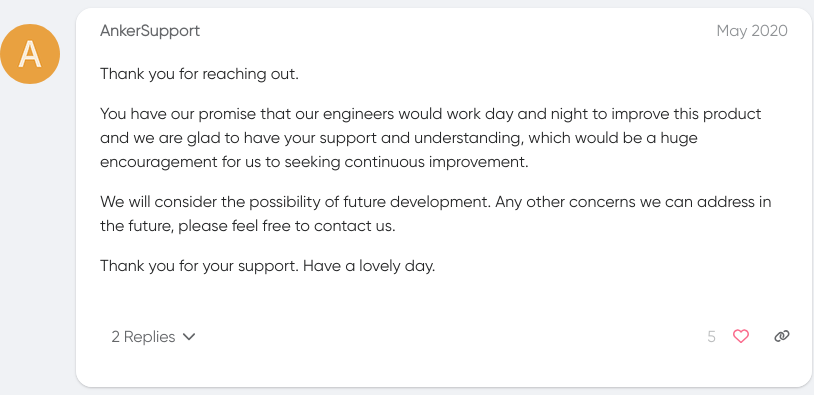

# Eufy Local Light for Home Assistant

Local control of Eufy string lights as a native Home Assistant light entity: power, brightness, RGB, warm/cool white, and the app's own preset effects over an encrypted Bluetooth Low Energy (BLE) session.

> This is an unofficial community integration built by reverse-engineering the Eufy app's BLE traffic. It is not affiliated with or endorsed by Anker/Eufy. It was developed and tested against the Eufy Outdoor String Lights E10 (model T8L10) and the Eufy Permanent Outdoor Lights E22 (model T8L02). Other lights may work but are untested.

### But first!

And i took that personally.

## Requirements

- Home Assistant :)

## Installation

### HACS

1. In HACS, open the three-dot menu and choose Custom repositories.
2. Add `https://github.com/sudosaturn/eufy-local-ha` with category Integration.
3. Install Eufy Local Light, then restart Home Assistant.

### Manual

Copy `custom_components/eufy_local_ha` into your Home Assistant `config/custom_components/` directory and restart.

## Configuration

Add the integration via **Settings > Devices & services > Add integration > Eufy Local Light** (It will usually discover it automatically!).

You can choose whichever setup option works best for you:

### 1. Fully Local
If you want your lights completely local without needing an account or sending telemetry to Eufy all day:
1. Hold the button on the light controller box until the lights blinks twice to enter pairing mode.
2. Home Assistant will auto-detect the light's Bluetooth address and serial number, create a local encryption key, and youre done!

### 2. Sign in with Eufy Account (If you need to keep the Eufy App Working)
If you still neeed to use the official Eufy phone app alongside Home Assistant:
1. Enter your Eufy email and password (plus your 2FA verification code if you have it turned on).
2. Home Assistant will log in once to get your account ID and light's serial number so both Home Assistant and the Eufy app can control the lights.

### 3. Manual Entry
Mostly as a fallback if for some reason options 1 and 2 dont work. you'll need yo type in your 16-character serial number, and Eufy User ID.

## Options: color tuning

Raw sRGB doesnt seem to look right to me on these LEDs so i adjusted the saturation to to stops light colors from washing out to white (kinda).

(with that being said i am severly colorblind so it might not actually be as accurate as it seems to me)

Therefore you can tune these from Settings > Devices & services > Eufy Local Light > Configure:

| Option | Default | Effect |
| --- | --- | --- |
| Gamma | 1.7 | Higher deepens mixed colors |
| Saturation | 1.0 | 1.0 is fully vivid; lower keeps more pastel |
| Neutral threshold | 0.12 | How close to gray before a color is treated as white |
| White balance, green | 0.85 | Lower if whites look green |
| White balance, blue | 0.55 | Lower if whites look blue; raise if amber |

### If you're having issues and disconnections make sure that you don't have the Eufy app connected while using local mode!

If you're just here to get your lights working this probably won't be your cup of tea but feel free to see [PROTOCOL.md](PROTOCOL.md) for complete breakdown :)

License: [GPL](LICENSE)
